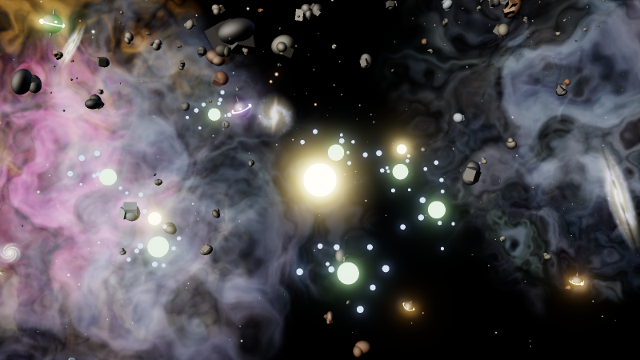
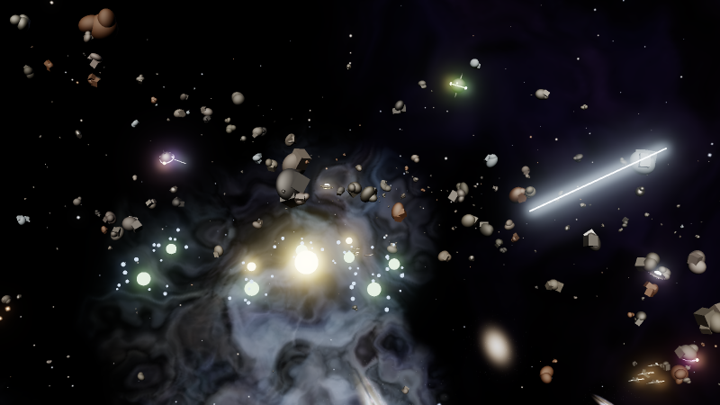
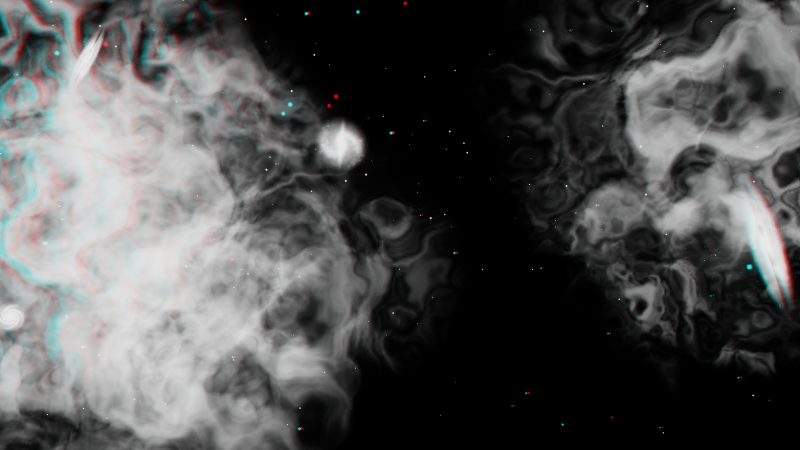

# Aether Brain in Unreal Engine

The **Unreal companion** draws your brain in Unreal Engine 5: the same suns, stars, planets and moons, in the same
places and colours, live. Every glow blooms, the orbits turn, and a whole [space](#the-space-around-it) hangs around
it: layers of stars, nebulae and far galaxies that slide against each other as you fly (parallax), asteroids going
round the brain and zooming through it, shooting stars, and alien ships. You fly through it with the mouse and WASD.
Click a star there and the desktop app flies to it too; double-click a note and it opens in the desktop app.



*That picture is a software preview made from the same maths the viewer uses (`unreal/tests/preview.sh`), not a
screenshot of Unreal: Unreal draws it with real lighting, bloom and 3D.*

It is a viewer. Your notes, the editor, the chat, the librarian and Concept Forge stay in the desktop app, which
remains the one place anything is written. The Unreal app reads the scene from the desktop app on your own computer
(127.0.0.1), live.

```
 Aether Brain (desktop)                         Aether Brain Viewer (Unreal Engine 5.8)
 ┌───────────────────────┐   127.0.0.1:7459     ┌──────────────────────────────────────┐
 │ notes · layout · AI    │ ── scene, 10×/s ───▶ │ glowing spheres, orbits, links, bloom │
 │ companion link (a)     │ ◀── select / open ── │ fly: mouse + WASD · click · Enter     │
 └───────────────────────┘                      └──────────────────────────────────────┘
```

- [What you need](#what-you-need)
- [Build it (once)](#build-it-once)
- [Use it](#use-it)
- [Keys](#keys)
- [The space around it](#the-space-around-it)
- [How it works](#how-it-works)
- [Privacy](#privacy)
- [Change how it looks](#change-how-it-looks)
- [Troubleshooting](#troubleshooting)

## What you need

- **Unreal Engine 5.8**, from the Epic Games Launcher.
- **Visual Studio 2022** with the *Game development with C++* workload (Windows), or Xcode (macOS). The viewer has a
  little C++, so Unreal compiles it the first time you open it.
- **Aether Brain 0.8** or later (the desktop app), with a vault open.

## Build it (once)

1. Get the project: every release has it as `AetherBrain-Unreal-<version>.zip` next to the installers (with a
   `START-HERE.txt`); or it is the `aether-brain/unreal/AetherBrainViewer` folder of this repository (download the
   source zip from GitHub, or clone it).
2. Double-click `AetherBrainViewer.uproject`. Unreal asks to build the missing modules: press **Yes**. It takes a
   few minutes the first time.
   - If it says it can't build them, right-click the `.uproject` → *Generate Visual Studio project files*, open the
     `.sln`, build *Development Editor*, then open the `.uproject` again.
3. The editor opens. On its first start it makes four assets by itself, in `Content/AetherBrain/` (see the Output Log):
   `M_AetherNode` (the glow material), `M_AetherSprite` (the sky's material), `M_AetherRock` (the lit material of
   rocks and ships) and `Maps/Brain` (an empty level of space). Nothing to click.
4. Optional: a standalone `AetherBrainViewer.exe` you can start without the editor. Close the editor, then double-click
   `unreal/PackageWindows.bat` (it finds Unreal Engine 5.8 in `C:\Program Files\Epic Games\UE_5.8`, or in the folder
   named by `UE_ROOT`, builds, cooks and packages; 10 to 30 minutes the first time) and take the program from
   `unreal/Packaged/Windows/`. Or, inside the editor: **Platforms → Windows → Package Project**. The batch file
   is not run by the repository's tests: it drives Unreal's own build tool, which is not available there.

## Use it

1. In the desktop app press <kbd>a</kbd> and, under **Unreal companion**, switch the **companion link on** (or run
   **Unreal companion link: on / off** from the palette).
2. In Unreal press **Play** (or start the packaged `.exe`). It finds the desktop app by itself, and the brain
   appears. The desktop app's panel says *The Unreal app is showing this brain*.
3. Fly. Whatever you do in the desktop app shows up at once: a new note is a new moon, switching the layout
   (<kbd>t</kbd>) moves everything, a new colour mode recolours it, and what you select there is where the Unreal
   camera flies.

You can leave the link on. It costs nothing while no viewer reads it: the desktop app sends the scene only while
the Unreal app is asking for it.

## Keys

| Key | Does |
|---|---|
| hold right mouse + move | look around |
| <kbd>W</kbd> <kbd>A</kbd> <kbd>S</kbd> <kbd>D</kbd> | fly forward, left, back, right |
| <kbd>Q</kbd> / <kbd>E</kbd> | down / up |
| <kbd>Shift</kbd> | 4× faster |
| mouse wheel | slower / faster (the speed is on screen) |
| click a node | select it: the camera flies to it, and the desktop app selects it and flies there too |
| double-click a node, or <kbd>Enter</kbd> | open it in the desktop app (a note in the editor; anything else is selected there) |
| <kbd>F</kbd> | fly to the selection |
| <kbd>H</kbd> or <kbd>Home</kbd> | fly back to see everything |
| <kbd>Tab</kbd> | the next project star |
| <kbd>B</kbd> | the space: **full** (sky, rocks, shooting stars, ships) → **calm** (the sky only) → **off** (plain black, the brain's own plain stars) |
| <kbd>N</kbd> | the Niagara effects (pulses along links, coronas, ripples, dust, shooting stars): on / off. See [UNREAL-NIAGARA.md](UNREAL-NIAGARA.md) |

The name of what is under the cursor floats next to it; suns, stars and planets carry their names.

## The space around it

Nothing to import: the pictures are generated when you press Play, and the rocks and ships are built from Unreal's
basic shapes.

| What | What you see |
|---|---|
| **Stars** | Nine layers from the deep sky to dust a few metres off. The far ones stay put on screen; the near ones are left behind as you fly, so the sky has depth. About 2,260 stars, bright ones with a four-point glint, blue-white to orange |
| **Nebulae** | Clouds of gas in pink, teal, amber, violet, green and red, with bright filaments and dark dust lanes; a pale **Milky Way** band across the sky; a few vivid ones placed in front of the first view |
| **Far galaxies** | Spirals (two arms, grand-design four-arm, barred), edge-on ones with a dust lane, ellipticals. Slowly turning |
| **Asteroids** | About 900 rocks going round the brain in three belts (level, tilted, nearly polar) and on loose orbits, some ambling and some racing, some the other way round; 70 bigger ones zooming through on their own paths. Each is a rubble pile of rounded and angular lumps in grey, charcoal, rust, ice or metal, lit by a warm key light and a cool fill |
| **Shooting stars** | Forty streaks of light crossing the sky at 140 to 260 m a second |
| **Alien ships** | Five **saucers** on patrol, their rim lights turning; two **squadrons** of four **darts** zooming through in formation; two huge **mother ships** (50 to 75 m long, ribs and windows lit) sailing slowly past; six **orb scouts** darting about. Every faction has its own glow colour |



The whole scene is laid out around your brain and **widens with it**: a bigger vault pushes the belts and ship
paths out (smoothly, never with a jump). A rock or a shooting star may cross the brain's space; ships never do:
saucers and scouts circle it, squadrons and mother ships pass outside it.

**Parallax.** Press <kbd>H</kbd>, then fly sideways, and watch the stars and the nebulae: the near ones slide past
the far ones. The picture below overlays two views from before and after a flight (red: before, cyan: after). The
deep stars and far galaxies coincide (white), the dust and the near nebulae split into red and cyan copies: that
split is the depth.



Press <kbd>B</kbd> to cycle *full*, *calm* and *off*. If the frame rate drops, set **Density** to 0.5 (see
[Change how it looks](#change-how-it-looks)): the numbers below are what is drawn, and none of it is measured on
your computer yet.

## Niagara effects

On top of the brain and the space there is a layer of **Niagara effects** (v0.9.0): light that runs along the links, a
breathing corona round each sun and a halo on the selection, a ripple when something is selected, dust drifting round the
camera, and shooting stars. <kbd>N</kbd> switches them. The C++ that plays them is in the project; the five Niagara
systems themselves are made once in the editor from the recipes in [UNREAL-NIAGARA.md](UNREAL-NIAGARA.md) (nothing outside
the editor can write a Niagara asset), and an effect whose system is missing is simply not played.

## How it works

The desktop app's **companion link** is a small HTTP server on `127.0.0.1` (port 7459 by default), off until you
switch it on. While it runs it writes its address and a secret token to `companion.json` in the app's data folder
(`%APPDATA%\Aether Brain\` on Windows, `~/Library/Application Support/Aether Brain/` on macOS,
`~/.config/Aether Brain/` on Linux), and deletes it when it stops. The viewer reads that file, so there is
nothing to copy.

| Request | Answer |
|---|---|
| `GET /v1/hello` | the app, its version, the vault's name |
| `GET /v1/graph` | JSON: every node (id, title, kind, colour, radius, parent), the links as index pairs, the selection, the layout. `ETag`, so asking again costs a `304` until something changes |
| `GET /v1/positions` | binary: a 16-byte header (`AEP1`, graph version, node count, ring count), then x y z per node and 6 floats per orbit ring (parent, radius, quaternion), little-endian float32 |
| `POST /v1/select` | `{"id": "...", "open": false}`: the desktop app selects the node and flies to it (with `open: true` it opens it) |

Every request carries `Authorization: Bearer <token>`. The scene is the one the desktop window draws, in its
current layout and colour mode. The desktop app publishes it only while a viewer asks (graph on change, positions
up to 10 times a second). The viewer eases toward the positions, so orbits keep turning smoothly between frames.

In Unreal everything is a handful of instanced meshes (one draw call each): spheres for nodes, thin cylinders for
links and orbit rings. The glow material reads each instance's colour and glow from its custom data. A
post-process volume fixes the exposure and adds bloom. The game mode sets all of this up in any level, so the
`Brain` map is just empty space.

**The space** is a second actor, `AetherSpaceActor`, that the game mode adds next to the brain:

- *The sky* is nine layers of flat sprites (planes with a generated picture, drawn additively) in 27 instanced
  components. Each layer has a distance and a *follow* number. The layer's centre sits at the camera minus
  `(1 - follow) × camera position`, softly capped at a third of its radius so you can never fly into it; follow 1
  never moves on screen (a sky), follow 0.25 is left behind quickly (dust). Each layer also turns a little by
  itself, so a still camera still sees a living sky.
- *The pictures* (nebulae, galaxies, the star dot) are made at start by `Private/AetherSpaceMath.h`: domain-warped
  fractal noise, ridged filaments, logarithmic spiral arms, a dust lane. 256 px by default (**Texture Size**).
- *Everything that moves* (rocks, shooting stars, ships) is a **pure function of time**: a belt rock's place is a
  circle in a tilted plane; a pass is a straight line with an exact closest approach to the brain; a ship's place
  comes from its path. There is nothing to save, respawn or keep in step. Each frame the actor evaluates them and
  writes all transforms of a component in one call (`BatchUpdateInstancesTransforms`): about 3,250 instances in 6
  components (lit spheres, cylinders, cones and cubes, glowing spheres and cylinders).
- *Ships* are built from the engine's sphere, cylinder, cone and cube: a saucer is a flat ellipsoid with a glowing
  dome and twelve rim lights; a dart a fuselage, a nose cone, swept wings and two engines with exhaust; a mother
  ship an elongated hull with prongs, glowing ribs and windows; an orb a sphere with a glowing ring and antennae.
- *Light*: a warm key and a cool fill (directional lights, no shadows) light the rocks and hulls through
  `M_AetherRock`; everything glowing uses `M_AetherNode`. The stage's exposure is fixed (EV 0), so a glow of 1
  stays as bright as it is drawn and values above 1 bloom.

**The Niagara layer** is a third actor, `AetherFxActor`, that the game mode adds (switch off with **Spawn Fx**). It makes a
fixed pool of Niagara components for each of five systems and plays them by setting their User parameters from the live
brain (links, selection, positions, the camera); `Private/AetherFxMath.h` plans what happens when, as plain C++ and pure
functions of time. Details, the parameter contract and the recipes: [UNREAL-NIAGARA.md](UNREAL-NIAGARA.md).

Any other program can read the same link. A web page can't: it has no token, and the link sends no CORS headers.

## Privacy

- **Off by default**, and only on `127.0.0.1`: nothing on your network or the internet can reach it.
- **The viewer sees titles, colours and positions**, not what your notes say: no note text, no tags, no tasks.
- **It can only select a node, or open a note that exists**, the same as a click in the desktop app. It can't
  write, move or delete anything (a note that is only a link target is selected, never created).
- **The token** is in `companion.json`, readable only by you. **New token…** in the panel makes a new one; the
  viewer picks it up by itself.

## Change how it looks

In the level, place an **Aether Brain Actor** (search for it in *Place Actors*) to change its settings. The game
mode only adds one when the level has none.

| Setting | |
|---|---|
| World Scale | centimetres per brain unit (20). Bigger: a bigger brain, slower to cross |
| Glow Scale | every glow ×; bloom starts above 1 |
| Show Links / Show Orbits, Max Links | the threads; big vaults may want fewer |
| Max Labels | how many suns, stars and planets carry a name |
| Follow Brain Selection | fly where the desktop app's selection goes |
| Url / Token | only to connect to a link by hand (otherwise `companion.json`) |

To change the space, place an **Aether Space Actor** in the level (the game mode adds one only when there is none):

| Setting | |
|---|---|
| Mode | what is shown at the start: Full, Calm, Off (<kbd>B</kbd> cycles it while playing) |
| Density | multiplies how many stars, rocks, streaks and ships there are (1) |
| Asteroid Count, Flyby Rock Count, Shooting Star Count | the counts before Density (900, 70, 40) |
| Asteroid Scale | how big the rocks are drawn (1) |
| Time Scale | how fast everything moves (1; 0 freezes it) |
| Sky Glow | the brightness of stars, nebulae and galaxies (1) |
| Texture Size | width of the generated nebula and galaxy pictures: bigger is softer and slower to start (256) |
| Seed | the same number gives the same sky |
| Stage Lights | the key and fill lights on the rocks and ships |

The materials `Content/AetherBrain/M_AetherNode`, `M_AetherSprite` and `M_AetherRock` are yours to edit (keep their
four per-instance custom data inputs, and `Tex` on the sprite material). Each is made once and then left alone:
delete one and reopen the editor to make it again. The stage is a post-process volume made at start: place your own to change bloom, exposure, lens flares or
Lumen settings. The game mode then leaves it alone.

## Troubleshooting

| You see | Do |
|---|---|
| *Aether Brain's companion link is off* | Switch it on in the desktop app (<kbd>a</kbd> → Unreal companion). The viewer checks every 2 seconds |
| *Can't reach Aether Brain* | The desktop app is closed, or another program holds port 7459: change the port in the panel |
| *Waiting for Aether Brain to show a vault* | Open a vault in the desktop app |
| *Glow material missing*, everything grey | Open the project in the Unreal Editor once with the Python Editor Script Plugin on (the `.uproject` turns it on). Then package again |
| *Sky material missing*, plain black behind the brain | Open the project in the Unreal Editor once (the Python plugin makes `M_AetherSprite`). The brain draws its own plain stars meanwhile |
| Grey squares where the nebulae should be | `M_AetherSprite` did not compile: delete it in `Content/AetherBrain` and reopen the editor to make it again (the Output Log says why if it can't) |
| Rocks and ships look flat or very dark | `M_AetherRock` is missing (see above) or *Stage Lights* is off. The lights are on the Aether Space Actor: raise the key light's intensity there |
| The viewer is slow | Set **Density** to 0.5 on an Aether Space Actor, or press <kbd>B</kbd> for *calm* or *off*; <kbd>N</kbd> switches the Niagara effects off |
| *Niagara systems missing (not played)* | Make them from [UNREAL-NIAGARA.md](UNREAL-NIAGARA.md) and save them in `Content/AetherFX` with those names |
| Grey spheres in a packaged build only | Make sure `Content/AetherBrain` (and `Content/AetherFX`) is cooked: the project's `DefaultGame.ini` lists both under *Directories to always cook* |
| Right mouse doesn't look around | Click into the game window first; the project's `DefaultInput.ini` captures the mouse only while the right button is down |
| The link works but the viewer refuses the token | Press **New token…** in the panel; the viewer reads `companion.json` again |

## Check it without Unreal

The space world's logic is plain C++ that does not need Unreal, so it is tested on an ordinary computer:

```
unreal/tests/run.sh        # compiles with strict warnings and runs, four stages: the space maths, the space actor against a stand-in engine, the Niagara maths, the Niagara actor against the stand-in (fake Niagara components)
unreal/tests/preview.sh    # draws the pictures above (needs Python 3 for the PNGs)
```

`space_core_test.cpp` checks the maths (the generated pictures have no visible edge and are never blown out, the
parallax is capped and ordered by depth, a pass never misses the brain by less than it should, ships point the way
they fly). `actor_harness.cpp` compiles the real `AetherSpaceActor.cpp` against `ue_stubs/` (a stand-in for the part
of Unreal's API it uses), flies a camera for ten seconds and checks the actor's bookkeeping: instance counts, one
update per frame, which material each part wears, the parallax wiring, the modes. `fx_core_test.cpp` and
`fx_actor_harness.cpp` do the same for the Niagara layer (see [UNREAL-NIAGARA.md](UNREAL-NIAGARA.md)). `pnpm test` runs
all four when a C++ compiler is installed. What this cannot say is how Unreal compiles or draws it: that needs you to open the project
(the stand-in follows Unreal 5's API as the plugin uses it, from memory of that API).
