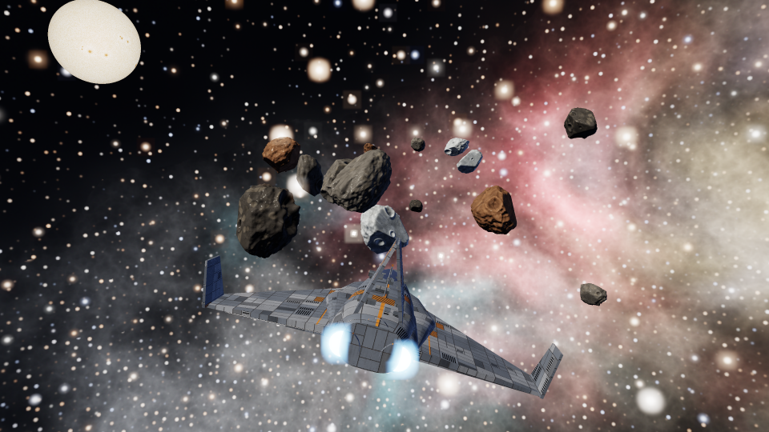
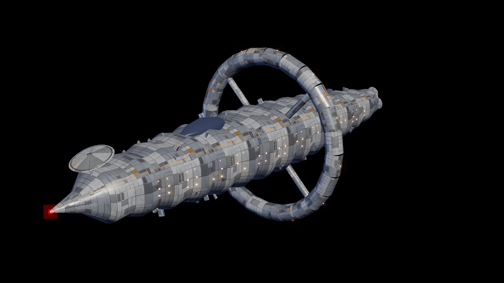

# Aether Brain in Unreal Engine

The **Unreal companion** draws your brain in Unreal Engine 5: the same suns, stars, planets and moons, in the same
places and colours, live. Every glow blooms, the orbits turn, and a whole [space](#the-space-around-it) hangs around
it: layers of stars, nebulae and far galaxies that slide against each other as you fly (parallax), asteroids going
round the brain and zooming through it, shooting stars, and alien ships. You fly through it with the mouse and WASD.
Click a star there and the desktop app flies to it too; double-click a note and it opens in the desktop app.

On top of that sits **the Voyage**: an 8K nebula sky and 8K suns with a corona, ships with painted, scratched, riveted
metal, folders that show an extra-large picture of what is inside them, and a key (<kbd>V</kbd>) that flies your own
ship to the selected folder through asteroid fields you can shoot to pieces. See [The Voyage](#the-voyage).



*A software preview of the Voyage, made by the very generators the viewer uses (`unreal/tests/voyage_preview.sh`).
Unreal draws it with real lighting, bloom and 8K, and will look better.*


*That picture is a software preview made from the same maths the viewer uses (`unreal/tests/preview.sh`), not a
screenshot of Unreal: Unreal draws it with real lighting, bloom and 3D.*

It is a viewer. Your notes, the editor, the chat, the librarian and Concept Forge stay in the desktop app, which
remains the one place anything is written. The Unreal app reads the scene from the desktop app on your own computer
(127.0.0.1), live.

```
 Aether Brain (desktop)                         Aether Brain Viewer (Unreal Engine 5.8)
 ┌───────────────────────┐   127.0.0.1:7459     ┌──────────────────────────────────────┐
 │ notes · layout · AI    │ ── scene, 10×/s ───▶ │ glowing spheres, orbits, links, bloom │
 │ companion link (a)     │ ◀── select / open ── │ fly: mouse + WASD · click · Enter     │
 └───────────────────────┘                      └──────────────────────────────────────┘
```

- [What you need](#what-you-need)
- [Build it (once)](#build-it-once)
- [Use it](#use-it)
- [Keys](#keys)
- [The space around it](#the-space-around-it)
- [The Voyage](#the-voyage)
- [How it works](#how-it-works)
- [Privacy](#privacy)
- [Change how it looks](#change-how-it-looks)
- [Troubleshooting](#troubleshooting)

## What you need

- **Unreal Engine 5.8**, from the Epic Games Launcher.
- **Visual Studio 2022** with the *Game development with C++* workload (Windows), or Xcode (macOS). The viewer has a
  little C++, so Unreal compiles it the first time you open it.
- **Aether Brain 0.8** or later (the desktop app), with a vault open.

## Build it (once)

1. Get the project: every release has it as `AetherBrain-Unreal-<version>.zip` next to the installers (with a
   `START-HERE.txt`); or it is the `aether-brain/unreal/AetherBrainViewer` folder of this repository (download the
   source zip from GitHub, or clone it).
2. Double-click `AetherBrainViewer.uproject`. Unreal asks to build the missing modules: press **Yes**. It takes a
   few minutes the first time.
   - If it says it can't build them, right-click the `.uproject` → *Generate Visual Studio project files*, open the
     `.sln`, build *Development Editor*, then open the `.uproject` again.
3. The editor opens. On its first start it makes its assets by itself, in `Content/AetherBrain/` (see the Output Log):
   `M_AetherNode` (the glow material), `M_AetherSprite` (the space's sky material), `M_AetherRock` (the lit material of
   the space's rocks and ships), `Maps/Brain` (an empty level of space) and, for [the Voyage](#the-voyage), eight more
   materials: `M_AetherSky`, `M_AetherSun`, `M_AetherCorona`, `M_AetherHull`, `M_AetherGlass`, `M_AetherLight`,
   `M_AetherRockPBR` and `M_AetherCard`. Nothing to click.
4. Optional: a standalone `AetherBrainViewer.exe` you can start without the editor. Close the editor, then double-click
   `unreal/PackageWindows.bat` (it finds Unreal Engine 5.8 in `C:\Program Files\Epic Games\UE_5.8`, or in the folder
   named by `UE_ROOT`, builds, cooks and packages; 10 to 30 minutes the first time) and take the program from
   `unreal/Packaged/Windows/`. Or, inside the editor: **Platforms → Windows → Package Project**. The batch file
   is not run by the repository's tests: it drives Unreal's own build tool, which is not available there.

## Use it

1. In the desktop app press <kbd>a</kbd> and, under **Unreal companion**, switch the **companion link on** (or run
   **Unreal companion link: on / off** from the palette).
2. In Unreal press **Play** (or start the packaged `.exe`). It finds the desktop app by itself, and the brain
   appears. The desktop app's panel says *The Unreal app is showing this brain*.
3. Fly. Whatever you do in the desktop app shows up at once: a new note is a new moon, switching the layout
   (<kbd>t</kbd>) moves everything, a new colour mode recolours it, and what you select there is where the Unreal
   camera flies.

You can leave the link on. It costs nothing while no viewer reads it: the desktop app sends the scene only while
the Unreal app is asking for it.

## Keys

| Key | Does |
|---|---|
| hold right mouse + move | look around |
| <kbd>W</kbd> <kbd>A</kbd> <kbd>S</kbd> <kbd>D</kbd> | fly forward, left, back, right |
| <kbd>Q</kbd> / <kbd>E</kbd> | down / up |
| <kbd>Shift</kbd> | 4× faster |
| mouse wheel | slower / faster (the speed is on screen) |
| click a node | select it: the camera flies to it, and the desktop app selects it and flies there too |
| double-click a node, or <kbd>Enter</kbd> | open it in the desktop app (a note in the editor; anything else is selected there) |
| <kbd>F</kbd> | fly to the selection |
| <kbd>H</kbd> or <kbd>Home</kbd> | fly back to see everything |
| <kbd>Tab</kbd> | the next project star |
| <kbd>B</kbd> | the space: **full** (sky, rocks, shooting stars, ships) → **calm** (the sky only) → **off** (plain black, the brain's own plain stars) |
| <kbd>N</kbd> | the Niagara effects (pulses along links, coronas, ripples, dust, shooting stars): on / off. See [UNREAL-NIAGARA.md](UNREAL-NIAGARA.md) |
| <kbd>V</kbd> | **the Voyage**: fly your ship to the selected folder (or the one under the cursor, or the one most in front of you). Again, or <kbd>Esc</kbd> or right mouse, leaves it |

While you are on a Voyage:

| Key | Does |
|---|---|
| mouse | aim the cannon at the cursor |
| hold left mouse, or <kbd>Space</kbd> | fire where the cursor points |
| <kbd>A</kbd> <kbd>D</kbd> / <kbd>Q</kbd> <kbd>E</kbd> | steer left, right / down, up |
| <kbd>W</kbd> <kbd>S</kbd> or the wheel | the speed |
| <kbd>Enter</kbd> (once you have arrived) | open the folder in the desktop app |
| <kbd>V</kbd>, <kbd>Esc</kbd> or right mouse | leave the Voyage (the camera stays where it is) |

The name of what is under the cursor floats next to it; suns, stars and planets carry their names.

## The space around it

Nothing to import: the pictures are generated when you press Play, and the rocks and ships are built from Unreal's
basic shapes.

| What | What you see |
|---|---|
| **Stars** | Nine layers from the deep sky to dust a few metres off. The far ones stay put on screen; the near ones are left behind as you fly, so the sky has depth. About 2,260 stars, bright ones with a four-point glint, blue-white to orange |
| **Nebulae** | Clouds of gas in pink, teal, amber, violet, green and red, with bright filaments and dark dust lanes; a pale **Milky Way** band across the sky; a few vivid ones placed in front of the first view |
| **Far galaxies** | Spirals (two arms, grand-design four-arm, barred), edge-on ones with a dust lane, ellipticals. Slowly turning |
| **Asteroids** | About 900 rocks going round the brain in three belts (level, tilted, nearly polar) and on loose orbits, some ambling and some racing, some the other way round; 70 bigger ones zooming through on their own paths. Each is a rubble pile of rounded and angular lumps in grey, charcoal, rust, ice or metal, lit by a warm key light and a cool fill |
| **Shooting stars** | Forty streaks of light crossing the sky at 140 to 260 m a second |
| **Alien ships** | Five **saucers** on patrol, their rim lights turning; two **squadrons** of four **darts** zooming through in formation; two huge **mother ships** (50 to 75 m long, ribs and windows lit) sailing slowly past; six **orb scouts** darting about. Every faction has its own glow colour |


The whole scene is laid out around your brain and **widens with it**: a bigger vault pushes the belts and ship
paths out (smoothly, never with a jump). A rock or a shooting star may cross the brain's space; ships never do:
saucers and scouts circle it, squadrons and mother ships pass outside it.

**Parallax.** Press <kbd>H</kbd>, then fly sideways, and watch the stars and the nebulae: the near ones slide past
the far ones. The picture below overlays two views from before and after a flight (red: before, cyan: after). The
deep stars and far galaxies coincide (white), the dust and the near nebulae split into red and cyan copies: that
split is the depth.


Press <kbd>B</kbd> to cycle *full*, *calm* and *off*. If the frame rate drops, set **Density** to 0.5 (see
[Change how it looks](#change-how-it-looks)): the numbers below are what is drawn, and none of it is measured on
your computer yet.

## The Voyage

Nothing to import and nothing stored in the project: the sky, the suns, the ships' metal and the rocks' stone are all
**made in code when you press Play**, on background threads, a few at a time (the sky first, then the suns, the first
ship, the rocks, the other ships), and appear as they are ready. The flat sky of the space steps aside when the 8K
sky is up. A line near the top says what is still being made.



| What | What you see |
|---|---|
| **The sky** | An 8K (8192 × 4096) nebula sky on a sphere round the camera: gas clouds in colour with dust lanes, a Milky Way band, tens of thousands of stars with the colour of their temperature and a soft glow on the bright ones. Painted by direction, so there is no seam and no pinch at the poles. 128 MB of video memory (and about a third more for its mips) |
| **Suns** | Every sun (a drive or vault root) has a surface picture, 8K by default: granulation, sunspots, bright faculae, limb darkening, in a colour that follows its temperature (red, yellow or blue: up to three pictures, 128 MB each), and a soft corona that always faces you. Values above 1 bloom |
| **Ships** | Three ships built in code: an **interceptor** (15 m, the one you fly), a **freighter** (112 m) and a **research cruiser** (190 m, with a ring and lit windows). Lofted hulls, wings, nozzles and plates, with real metal: a painted, scratched, riveted base colour, a normal map with panel lines and rivets, and roughness / metal / occlusion maps, 2048 px by default, tiling so a big hull is not blurry. A few ships (the **traffic**) drift past the brain; engines and windows glow |
| **Asteroids** | Four kinds of rock (silicate, carbon, iron, ice) as real lumpy meshes with craters, cracks and veins and their own normal and roughness maps |
| **Folder pictures** | A folder shows an **extra-large picture card** of what is inside it: the cover the desktop app names (a folder's newest picture, or one of its pictures, a video as a still), as a card at least 9 m wide (more for a big folder: 14 times its radius) that always faces you, floating in front of the folder's sphere, with the picture's own proportions. The viewer asks the desktop app for each as a PNG (`/v1/thumb`, up to 1024 px) for the nearest 24 folders only, and lets go of the farthest ones |

### Flying to a folder

Select a folder in the viewer (or point at it, or just look at one) and press <kbd>V</kbd> (a note flies to its folder). Your interceptor appears and flies the curved
**route** to the folder through fields of asteroids laid along it, the camera behind and above it. Steer with
<kbd>A</kbd> <kbd>D</kbd> <kbd>Q</kbd> <kbd>E</kbd>, set the speed with <kbd>W</kbd> <kbd>S</kbd> or the wheel, and
**shoot where the cursor points** (hold left mouse or <kbd>Space</kbd>): two converging barrels, and bolts that hit what is on
their way even at speed (a bolt is swept along its path, so it never passes through a rock between frames). The guns follow the
cursor up to 38 degrees off the nose and lead a moving rock; when the cursor is not on a rock, the sights pick the rock nearest
the nose and lead that one. A rock that is hit **breaks into smaller rocks and dust**, down to pebbles; the pieces fly apart and
can be shot too. A rock that hits you is destroyed and costs **shield** first (it comes back after about three seconds without a
hit), then **hull**. There is no game over: the hull is how the flight went, and the flight always ends at the folder. While you
are not steering yourself, an assist steers round rocks that are in the way. The ship brakes in time to stop in front of the
folder's card (a big folder stands off farther, by the card's width), the top line says *Arrived*, and <kbd>Enter</kbd> opens the
folder in the desktop app.

The lines at the top show how far you have to go, then shield, hull, rocks broken, score and speed; the line at the bottom
reminds you of the keys.

### What it costs

Video memory is what to watch. At the default settings:

| What | Size | Where it comes from |
|---|---|---|
| 8K sky | about 170 MB | **Sky Width** |
| three 8K suns | about 510 MB | **Sun Width** |
| three hulls' maps, four rock kinds' maps | about 450 MB | **Map Size** (2048) |
| folder cards | up to 130 MB | **Max Cards** (24) × **Card Pixels** (1024) |
| **together** | about **1.3 GB** | |

A graphics card with 6 GB or less should set **Sky Width** and **Sun Width** to 4096 (a quarter of it) and **Map Size** to
1024. The pictures are made in a few seconds on a modern processor, one at a time on background threads; the viewer is usable
meanwhile. Nothing grows without a bound: at most **Max Cards** cards are held (the nearest folders; the others let go of their
pictures), and a rock more than 600 m behind the ship is given back.

### What this is, honestly

- **Made in code, not photographed.** These are procedural: they are real 8K pictures and real PBR maps, and look
  convincing at a glance and in motion, but they are not photographs of the Orion Nebula or scans of a real hull. Expect
  "good space game", not film.
- **Your own sky.** To use a real HDRI or a photograph: switch **Photo Sky** off (the space's flat sprites draw instead) and
  put Unreal's own sky sphere or an HDRI backdrop in the level. To change how any part looks, edit the eight
  `M_Aether…` materials in `Content/AetherBrain` (each is made once and then left alone); their parameter names are the contract
  the C++ fills in (`Sky`, `Sun`, `BaseColor`, `Normal`, `ORM`, `Tex` on the card, and `Glow`, `Intensity`, `Brightness`, `Gain`
  numbers: see `init_unreal.py`).
- **The ships' shapes are in code** (`AetherShipMath.h`); using your own imported ship models would need a C++ change.
- **It has not been run in Unreal.** Like the rest of the viewer, this was written without Unreal installed, and tested
  on an ordinary computer: the maths (route, fields, shots, pieces, pilot, aim, meshes and pictures) at full strength, and
  the real actor files against a stand-in for the engine (see the end of this page). Parts of the Unreal API it uses
  (procedural meshes, building textures with mips in code, the HTTP module, the image wrapper) were written from memory
  of that API and may need a fix on your first compile: the error names the line; please send it back.

## Niagara effects

On top of the brain and the space there is a layer of **Niagara effects** (v0.9.0): light that runs along the links, a
breathing corona round each sun and a halo on the selection, a ripple when something is selected, dust drifting round the
camera, and shooting stars. <kbd>N</kbd> switches them. The C++ that plays them is in the project; the five Niagara
systems themselves are made once in the editor from the recipes in [UNREAL-NIAGARA.md](UNREAL-NIAGARA.md) (nothing outside
the editor can write a Niagara asset), and an effect whose system is missing is simply not played.

## How it works

The desktop app's **companion link** is a small HTTP server on `127.0.0.1` (port 7459 by default), off until you
switch it on. While it runs it writes its address and a secret token to `companion.json` in the app's data folder
(`%APPDATA%\Aether Brain\` on Windows, `~/Library/Application Support/Aether Brain/` on macOS,
`~/.config/Aether Brain/` on Linux), and deletes it when it stops. The viewer reads that file, so there is
nothing to copy.

| Request | Answer |
|---|---|
| `GET /v1/hello` | the app, its version, the vault's name |
| `GET /v1/graph` | JSON: the nodes (id, title, kind, colour, radius, parent), the links as index pairs, the selection, the layout, and `limits` (how many of how many nodes and links this is). `ETag`, so asking again costs a `304` until something changes |
| `GET /v1/positions` | binary: a 16-byte header (`AEP1`, graph version, node count, ring count), then x y z per node and 6 floats per orbit ring (parent, radius, quaternion), little-endian float32 |
| `GET /v1/thumb?id=<node id>&size=<px>` | a **PNG** of a picture: a picture node, or the cover of a folder (its newest picture, or one it holds; a video's first frame), at most `size` px on the longer side (64 to 1024, 512 if not said). Only ids of the published scene are served (never an arbitrary path); at most four at a time (`429` and `Retry-After` beyond that); `404` when there is no picture or it cannot be read |
| `POST /v1/select` | `{"id": "...", "open": false}`: the desktop app selects the node and flies to it (with `open: true` it opens it) |

Every request carries `Authorization: Bearer <token>`. The scene is the one the desktop window draws, in its
current layout and colour mode. The desktop app publishes it only while a viewer asks (graph on change, positions
up to 10 times a second). The viewer eases toward the positions, so orbits keep turning smoothly between frames.

**A big vault is cut to fit** (v0.9.2). Unreal makes a real object for every sphere and link and 48 pieces for every orbit
ring, and rewrites them all many times a second, so a drive with tens of thousands of notes and folders gave it a million
objects and a stall, and then *ran out of memory*. The desktop app therefore sends the most important part of a big brain
and says so (the panel: *It shows the 12,000 most important of 109,282 nodes*; the viewer's line at the bottom says it too):
every sun and the Today hub, the project stars with the most notes, the folders that hold the most, a few notes in each of
those (the most linked first, then the most that the budget leaves room for), the notes the Today hub points at, a few
pictures. At most 12,000 nodes, 8,000 links and 400 orbit rings, nothing more than about 40,000 things for Unreal to draw.
Every folder that is shown brings the folders above it, so what you see still orbits what it orbits in the desktop app, in
the same places. What you **select** is always shown (with its folders), so a note you search for in the desktop app is
there to fly to. Nothing is cut from a vault that fits.

Two more things the desktop app does so that the viewer shows the brain and not a clump: a vault that has just been opened
is sent only once its layout has grown out into its places (a second or two for a big one; the viewer says *Aether Brain
is working out where everything goes* until then), and the orbit rings are worked out from where the bodies finally sit.
Seen from the distance that frames the whole brain, a moon is a fraction of a pixel and an orbit thread thinner still, so
the viewer never draws a body or a thread thinner than a pixel or two, however far away (a sun a little bigger than a star,
a star than a planet, a planet than a moon).

The picture of a folder is a decision of the desktop app, not of the viewer: the brain window names a folder's cover in the
scene (`cover`) when it draws the folder's picture moons, and where it does not, the app works one out from the scan (the
picture that sorts last by name among those directly in the folder, a still before a video: names are often dates or
numbers, so that is usually the newest). Thumbnails are made in the app's hidden helper window like the brain's own, never in the
main process, and only for pictures of the vault.

In Unreal everything is a handful of instanced meshes (one draw call each): spheres for nodes, thin cylinders for
links and orbit rings. The glow material reads each instance's colour and glow from its custom data. A
post-process volume fixes the exposure and adds bloom. The game mode sets all of this up in any level, so the
`Brain` map is just empty space.

**The space** is a second actor, `AetherSpaceActor`, that the game mode adds next to the brain:

- *The sky* is nine layers of flat sprites (planes with a generated picture, drawn additively) in 27 instanced
  components. Each layer has a distance and a *follow* number. The layer's centre sits at the camera minus
  `(1 - follow) × camera position`, softly capped at a third of its radius so you can never fly into it; follow 1
  never moves on screen (a sky), follow 0.25 is left behind quickly (dust). Each layer also turns a little by
  itself, so a still camera still sees a living sky.
- *The pictures* (nebulae, galaxies, the star dot) are made at start by `Private/AetherSpaceMath.h`: domain-warped
  fractal noise, ridged filaments, logarithmic spiral arms, a dust lane. 256 px by default (**Texture Size**).
- *Everything that moves* (rocks, shooting stars, ships) is a **pure function of time**: a belt rock's place is a
  circle in a tilted plane; a pass is a straight line with an exact closest approach to the brain; a ship's place
  comes from its path. There is nothing to save, respawn or keep in step. Each frame the actor evaluates them and
  writes all transforms of a component in one call (`BatchUpdateInstancesTransforms`): about 3,250 instances in 6
  components (lit spheres, cylinders, cones and cubes, glowing spheres and cylinders).
- *Ships* are built from the engine's sphere, cylinder, cone and cube: a saucer is a flat ellipsoid with a glowing
  dome and twelve rim lights; a dart a fuselage, a nose cone, swept wings and two engines with exhaust; a mother
  ship an elongated hull with prongs, glowing ribs and windows; an orb a sphere with a glowing ring and antennae.
- *Light*: a warm key and a cool fill (directional lights, no shadows) light the rocks and hulls through
  `M_AetherRock`; everything glowing uses `M_AetherNode`. The stage's exposure is fixed (EV 0), so a glow of 1
  stays as bright as it is drawn and values above 1 bloom.

**The Voyage** is a fourth actor, `AetherVoyageActor` (**Spawn Voyage** on the game mode). Its logic is plain C++ with no Unreal
types, like the space's: the sky, sun and corona pictures (`Private/AetherSkyMath.h`), the mesh toolkit and the three ships with their
hull maps (`AetherMeshMath.h`, `AetherShipMath.h`), the asteroids and rock maps (`AetherRockMath.h`), the route, the fields, the
shots, the fracture, the shield and the pilot (`AetherCombatMath.h`) and one whole voyage with its cursor aim and chase camera
(`AetherVoyageState.h`). The actor builds a texture from each picture (box-filtered mips, held so the garbage collector keeps
them), a procedural mesh from each ship (one section per material zone) and instanced meshes for the rocks, bolts, pieces and
dust, and each frame only copies the state into transforms. The pictures are made one job at a time on background threads and picked up
on the game thread when done. Folder cards are fetched with Unreal's HTTP module from `/v1/thumb`, decoded by the image wrapper
module, and the farthest are released when more than **Max Cards** are held.

**The Niagara layer** is a third actor, `AetherFxActor`, that the game mode adds (switch off with **Spawn Fx**). It makes a
fixed pool of Niagara components for each of five systems and plays them by setting their User parameters from the live
brain (links, selection, positions, the camera); `Private/AetherFxMath.h` plans what happens when, as plain C++ and pure
functions of time. Details, the parameter contract and the recipes: [UNREAL-NIAGARA.md](UNREAL-NIAGARA.md).

Any other program can read the same link. A web page can't: it has no token, and the link sends no CORS headers.

## Privacy

- **Off by default**, and only on `127.0.0.1`: nothing on your network or the internet can reach it.
- **The viewer sees titles, colours and positions**, not what your notes say: no note text, no tags, no tasks.
- **It can only select a node, or open a note that exists**, the same as a click in the desktop app. It can't
  write, move or delete anything (a note that is only a link target is selected, never created).
- **The token** is in `companion.json`, readable only by you. **New token…** in the panel makes a new one; the
  viewer picks it up by itself.

## Change how it looks

In the level, place an **Aether Brain Actor** (search for it in *Place Actors*) to change its settings. The game
mode only adds one when the level has none.

| Setting | |
|---|---|
| World Scale | centimetres per brain unit (20). Bigger: a bigger brain, slower to cross |
| Glow Scale | every glow ×; bloom starts above 1 |
| Show Links / Show Orbits, Max Links, Max Rings | the threads; big vaults may want fewer (20,000 links and 400 orbit rings of 48 pieces each at most) |
| Max Labels | how many suns, stars and planets carry a name |
| Follow Brain Selection | fly where the desktop app's selection goes |
| Url / Token | only to connect to a link by hand (otherwise `companion.json`) |

To change the Voyage, place an **Aether Voyage Actor** in the level (the game mode adds one only when there is none):

| Setting | |
|---|---|
| Photo Sky | the 8K nebula sky; off keeps the space's flat sprites |
| Sky Width, Sun Width | pixels across (8192 = 8K, 4096 = 4K, 2048 = 2K for a weak card); the height is half |
| Sky Glow, Sun Glow | brightness of the sky (1) and of the suns' surfaces and coronas (6; above 1 blooms) |
| Map Size | width of the ships' metal maps and the rocks' maps (2048) |
| Ship Length Cm | how long your interceptor is (520) |
| Traffic Ships | ships drifting past the brain (4) |
| Asteroid Density | how many rock groups the flight holds (1; 0 for none) |
| Cruise Speed | your ship's speed, cm a second (3200) |
| Seed | the same number gives the same sky, ships and rocks |
| Folder Cards, Card Width Cm, Card Pixels, Max Cards, Card Range | the extra-large folder pictures: on (yes), at least this wide (900 cm), this many pixels (1024), at most this many held (24), none farther than this (60,000 cm) |
| Materials | the eight `M_Aether…` materials (made by `init_unreal.py`) |

To change the space, place an **Aether Space Actor** in the level (the game mode adds one only when there is none):

| Setting | |
|---|---|
| Mode | what is shown at the start: Full, Calm, Off (<kbd>B</kbd> cycles it while playing) |
| Density | multiplies how many stars, rocks, streaks and ships there are (1) |
| Asteroid Count, Flyby Rock Count, Shooting Star Count | the counts before Density (900, 70, 40) |
| Asteroid Scale | how big the rocks are drawn (1) |
| Time Scale | how fast everything moves (1; 0 freezes it) |
| Sky Glow | the brightness of stars, nebulae and galaxies (1) |
| Texture Size | width of the generated nebula and galaxy pictures: bigger is softer and slower to start (256) |
| Seed | the same number gives the same sky |
| Stage Lights | the key and fill lights on the rocks and ships |

The materials `Content/AetherBrain/M_AetherNode`, `M_AetherSprite` and `M_AetherRock` are yours to edit (keep their
four per-instance custom data inputs, and `Tex` on the sprite material). Each is made once and then left alone:
delete one and reopen the editor to make it again. The stage is a post-process volume made at start: place your own to change bloom, exposure, lens flares or
Lumen settings. The game mode then leaves it alone.

## Troubleshooting

| You see | Do |
|---|---|
| *Aether Brain's companion link is off* | Switch it on in the desktop app (<kbd>a</kbd> → Unreal companion). The viewer checks every 2 seconds |
| *Can't reach Aether Brain* | The desktop app is closed, or another program holds port 7459: change the port in the panel |
| *Waiting for Aether Brain to show a vault* | Open a vault in the desktop app |
| *Aether Brain is working out where everything goes* | The desktop app is laying a vault out (a second or two; a vault with tens of thousands of notes takes longer). It appears by itself |
| *This Aether Brain sends more of the brain than this viewer can draw* | The desktop app is older than the viewer (or the other way round): use the Aether Brain and the viewer from the same release |
| Everything is one clump, no orbits | Use the viewer and the desktop app from the same release (v0.9.2 or later). If it still happens, look at the line at the bottom: it says how many nodes and orbit rings are drawn |
| The first start of the editor takes minutes and the viewer is slow | The editor compiles the shaders of the project once (*Compiling Shaders* in the corner); wait until it reaches zero. A packaged `.exe` (`PackageWindows.bat`) does not do this each time, and is the better way to look at a very big vault |
| *Glow material missing*, everything grey | Open the project in the Unreal Editor once with the Python Editor Script Plugin on (the `.uproject` turns it on). Then package again |
| *Sky material missing*, plain black behind the brain | Open the project in the Unreal Editor once (the Python plugin makes `M_AetherSprite`). The brain draws its own plain stars meanwhile |
| Grey squares where the nebulae should be | `M_AetherSprite` did not compile: delete it in `Content/AetherBrain` and reopen the editor to make it again (the Output Log says why if it can't) |
| Rocks and ships look flat or very dark | `M_AetherRock` is missing (see above) or *Stage Lights* is off. The lights are on the Aether Space Actor: raise the key light's intensity there |
| *Voyage materials missing* (a line at the top), no photo sky, white or grey ships and suns | Open the project in the Unreal Editor once with the Python Editor Script Plugin on (it makes the eight `M_Aether…` voyage materials). Delete one in `Content/AetherBrain` and reopen to make it again |
| The sky or the suns take a long time to appear, or Unreal runs out of video memory | Set **Sky Width** and **Sun Width** to 4096 (or 2048) and **Map Size** to 1024 on the Aether Voyage Actor: at the defaults the Voyage holds about 1.3 GB |
| *Folder pictures: 0/N* | The desktop app's companion link is off or older than the viewer (use the same release), the folders hold no pictures, or the vault was opened without pictures. A folder with no picture shows its name only |
| V says *No folder to fly to* | Select a folder (a sun, a project star or a planet) first, or look at one. *You are already there* means the camera is already at it: fly away a little, or pick another |
| The viewer is slow | Set **Density** to 0.5 on an Aether Space Actor, or press <kbd>B</kbd> for *calm* or *off*; <kbd>N</kbd> switches the Niagara effects off |
| *Niagara systems missing (not played)* | Make them from [UNREAL-NIAGARA.md](UNREAL-NIAGARA.md) and save them in `Content/AetherFX` with those names |
| Grey spheres in a packaged build only | Make sure `Content/AetherBrain` (and `Content/AetherFX`) is cooked: the project's `DefaultGame.ini` lists both under *Directories to always cook* |
| Right mouse doesn't look around | Click into the game window first; the project's `DefaultInput.ini` captures the mouse only while the right button is down |
| The link works but the viewer refuses the token | Press **New token…** in the panel; the viewer reads `companion.json` again |

## Check it without Unreal

The space world's logic is plain C++ that does not need Unreal, so it is tested on an ordinary computer:

```
unreal/tests/run.sh        # compiles with strict warnings and runs, twelve stages and a unity-build check: the space maths, the space actor against a stand-in engine, the Niagara maths, the Niagara actor against the stand-in (fake Niagara components), the brain viewer's maths, the brain actor and scene reader against their own stand-in, then the Voyage: the sky and sun generators, the meshes and ships, the rocks, the combat maths, one whole voyage, and the real voyage actor against the stand-in
unreal/tests/preview.sh    # draws the pictures of the space above (needs Python 3 for the PNGs)
unreal/tests/voyage_preview.sh   # the Voyage: the chase view and an asteroid field
unreal/tests/ship_preview.sh     # the three ships and their hull maps
unreal/tests/rock_preview.sh     # the four kinds of rock and their maps
unreal/tests/sky_preview.sh      # the 8K-style sky, a sun and a corona
```

`space_core_test.cpp` checks the maths (the generated pictures have no visible edge and are never blown out, the
parallax is capped and ordered by depth, a pass never misses the brain by less than it should, ships point the way
they fly). `actor_harness.cpp` compiles the real `AetherSpaceActor.cpp` against `ue_stubs/` (a stand-in for the part
of Unreal's API it uses), flies a camera for ten seconds and checks the actor's bookkeeping: instance counts, one
update per frame, which material each part wears, the parallax wiring, the modes. `fx_core_test.cpp` and
`fx_actor_harness.cpp` do the same for the Niagara layer (see [UNREAL-NIAGARA.md](UNREAL-NIAGARA.md)). `view_core_test.cpp`
checks the viewer's own maths (how big a far body must be drawn, how often a big scene is redrawn, which body is under the
ray) and `brain_actor_harness.cpp` compiles the real `AetherBrainActor.cpp` and `AetherScene.cpp` against `brain_stubs/` and
checks what the viewer is sent and what it does with it: rings capped and rebuilt only when they changed, nothing drawn
before it has places, a scene too big to read, the status line, a flight that waits for the places. `pnpm test` runs
all of it when a C++ compiler is installed.

The Voyage's stages work the same way. `sky_core_test.cpp` checks that the sky, sun and corona pictures are the same whatever
the number of threads that make them, have no seam, and take their colour from the temperature. `ship_core_test.cpp` checks every
face of every ship points outward, the tangent frames are consistent, the two halves mirror, the sizes are right and the hull maps tile.
`rock_core_test.cpp` does the rocks. `combat_core_test.cpp` checks the route, that a swept shot never passes through a rock,
that a rock breaks into pieces whose volume adds up, the shield and hull, the autopilot and the aim. `voyage_core_test.cpp`
flies whole voyages (one idle, one fighting) and checks they arrive. `voyage_actor_harness.cpp` compiles the real
`AetherVoyageActor.cpp` with the real `AetherBrainActor.cpp` against the stand-in engine (with address and undefined-behaviour
checking where the compiler has it) and checks the bookkeeping: pictures made one at a time and turned into textures, the sky
up and the flat backdrop hidden, suns, traffic, a whole voyage through the actor, the folder cards fetched over a fake HTTP and
released when too many, and a missing material said out loud. `unity_check.cpp` joins the actors into one translation unit the
way Unreal's unity build does, to catch helper names that clash. What this cannot say is how Unreal compiles or draws it: that needs you to open the project
(the stand-in follows Unreal 5's API as the plugin uses it, from memory of that API).
